# Getting started

This tutorial walks through using Model Live Diagnostics (MLD) to:

- Load live and reference model runs
- Plot model data across various axes and slices
- Compare live and reference model data
- Run in-built analysis recipes on live models

------------------

### 1. Start an ARE session

Start an [ARE JupyterLab session](https://are.nci.org.au/pun/sys/dashboard/batch_connect/sys/jupyter/ncigadi/session_contexts/new) using the [ACCESS-NRI Analysis3 conda environment](https://docs.access-hive.org.au/getting_started/environments/), which has the `med_diagnostics` package pre-installed.
To follow this tutorial, you need to be a member of these NCI projects:

- `xp65`: For the Analysis3 conda environment and the [ACCESS-NRI Intake Catalogue](https://github.com/ACCESS-NRI/access-nri-intake-catalog).
- `ik11`: For the example ACCESS-OM2 run and the reference model runs used in this tutorial.
- Optionally, the project containing your own model output, if you want to use it instead of the example run.

Use the following settings:

| Setting | Recommendation |
| --- | --- |
| Compute size | XX-Large (28 CPUs, 126 GB memory) |
| Storage | `gdata/xp65+gdata/ik11`, plus `+gdata/<project>` or `+scratch/<project>` if using your own run |

In **Advanced options**, use:

| Setting | Value |
| --- | --- |
| Module directories | `/g/data/xp65/public/modules` |
| Modules | `conda/analysis3` |

### 2. Start a live model diagnostic session

In a new notebook, import the `med_diagnostics` package.

```python
import med_diagnostics
```

Start a session by running a cell with the following command:

```python
session = med_diagnostics.session.CreateModelDiagnosticsSession()
```

This starts the model diagnostics session, which initially should look like:

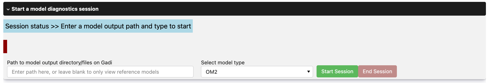{ width="70%" }

??? warning "Reopened notebooks"
    A notebook saved in an earlier session can still show the previous sessions start section, but it won't work. Run the `CreateModelDiagnosticsSession()` cell again to start a new session.

Now we are ready to load our model data and begin analysing it.

#### 2.1. Monitor your own run

In the start section, enter the path to your live model output, select its model type, and click <span style="color:green">**Start Session**</span>. If you want to use the model used in this tutorial, enter the model path below and select **OM2** from the model type dropdown. Information for each section is shown in the <span style="color:lightblue">status</span> and <span style="color:darkred">warning</span> information boxes. While MLD builds an intake catalogue of your live model output, the session summary and the following <span style="color:lightblue">status</span> message are shown. Depending on the size of the output, this can take several minutes. A session summary is printed above the interface, including the Dask cluster address (e.g. /proxy/8787/status). Add this to the **Dask Dashboard URL** in the JupyterLab left panel to monitor data loading.

```
/g/data/ik11/outputs/access-om2/1deg_jra55_iaf_omip2spunup_cycle41
```

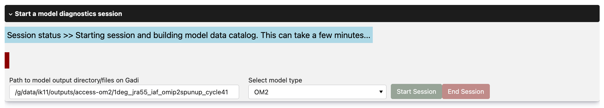{ width="70%" }

The start section collapses and four collapsible sections appear:

- **Load and plot user data** (Section 3)
- **Load and plot reference models** (Section 4)
- **Overlay user and reference models** (Section 5)
- **Run analysis recipes** (Section 6)

??? tip "Tutorial order"
    This tutorial covers the sections in order, but once the catalogue is built you can use them in any order.

#### 3. Loading and plotting user data

- The **Load and plot user data** section shows the <span style="color:orange">catalog</span>, indicating when the model catalog was most recently built/ updated. 

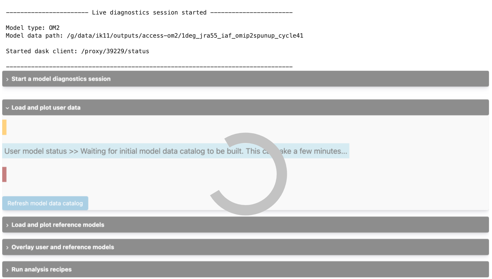{ width="70%" }

- Once the catalogue is built, the <span style="color:lightblue">status</span> message updates and the <span style="color:orange">catalog</span> box shows the date and time of the last catalogue build.

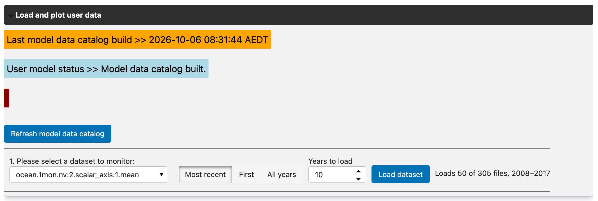{ width="70%" }

- The dropdown lists every dataset in your model output. Select the dataset you want to monitor, choose how many years to load (see the tip below), and click <span style="color:royalblue">**Load dataset**</span>.

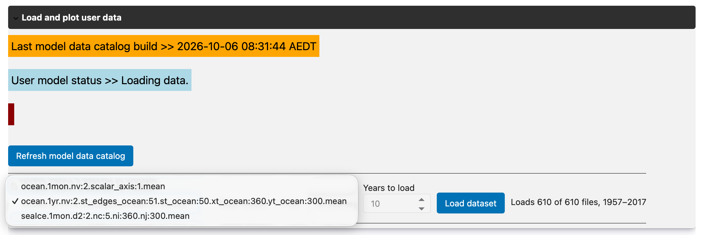{ width="70%" }

??? tip "Choosing how many years to load"
    Next to each dataset dropdown are the **Years to load** controls. Loading fewer years is the main way to keep load times and memory use down.

    - **Most recent**: load the last *N* years of output (the default, *N* = 10).
    - **First**: load the first *N* years of output.
    - **All years**: load every file in the dataset. The year box is disabled in this mode. This option may take significantly longer to load a dataset. 

    The text beside the button shows how many files and which years your selection will load, e.g. "Loads 10 of 120 files, 1991–2000". The user dataset is shared by all sections, so loading it in one section loads it (and its year selection) in the others too.

Once the dataset loads, the plotting controls appear. From here, you must:

- **Select a variable**: choose a model variable from the dropdown.
- **Choose a plot type**: Line, Heatmap or Interactive Heatmap. Datasets with fewer dimensions may only support line plots.

Then click the <span style="color:green">**Select variable and plot type**</span> button.

??? tip "Toggle variable names"
    Use the **Display Variable Long Names** checkbox to show long or short names, if the defaults are unclear.
    
The axis options depend on the plot type. For a line plot, select the x-axis dimension (e.g. time); for an interactive heatmap, assign dimensions to the X, Y and Z axes. Then click the <span style="color:green">**Select dimensions**</span> button.

If the variable has dimensions that aren't on an axis (e.g. ocean depth, or time), a slider appears for each so you can choose a slice. You can also type a value into the box under each slider. Depending on the dataset and plot type, there may be none. Choose your slices and click the <span style="color:green">**Plot data**</span> button to load the plot. 

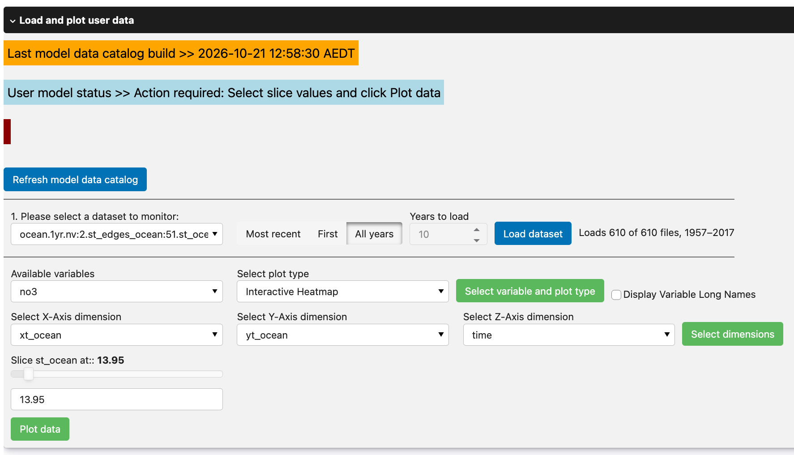{ width="70%" }

??? example "View generated plot"
    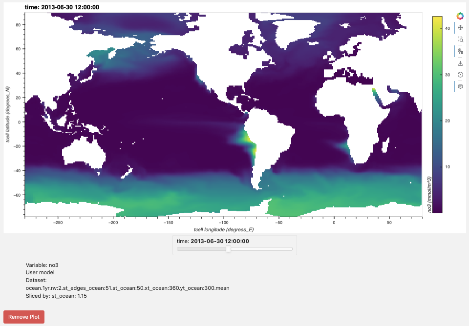{ width="70%" }

Each plot has a <span style="color:darkred">**Remove the above plot**</span> button beneath it, which removes that plot from the section.

??? tip "Optional"
    Repeat this with as many datasets, variables and plot types as you like. To monitor a different dataset, select it and click <span style="color:royalblue">**Load dataset**</span> again.
    As your run writes new output, click <span style="color:royalblue">**Refresh model data catalog**</span> to rebuild the catalogue, then reload your dataset to see the latest data.


### 4. Explore reference models

Reference models are existing ACCESS model runs of the selected type, found in the [ACCESS-NRI Intake Catalogue](https://github.com/ACCESS-NRI/access-nri-intake-catalog).

#### 4.1. Loading reference model data

- The reference model dropdown lists the catalogue's runs of models related to the selected type (here, every `OM2` run). Click <span style="color:royalblue">**Reference model information**</span> to see a description of the selected model. Choose a reference model and click <span style="color:royalblue">**Load reference model**</span>.

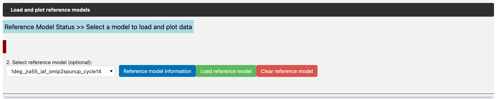{ width="70%" }

- Once the reference model loads, a second dropdown lists its datasets. Select the dataset you want to view and click <span style="color:royalblue">**Load reference dataset**</span>.

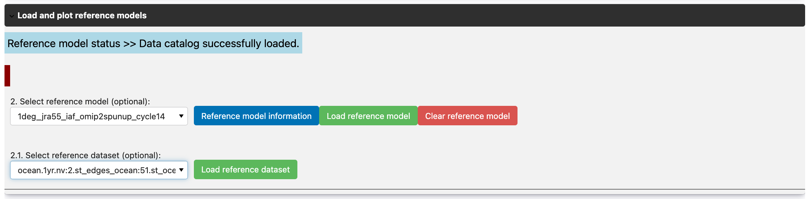{ width="70%" }

#### 4.2. Plotting data

Plotting reference datasets follows the same steps outlined in section 3.1. 

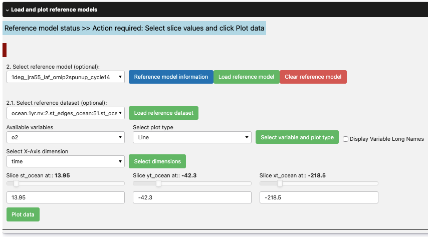{ width="70%" }

??? example "View reference data plot"
    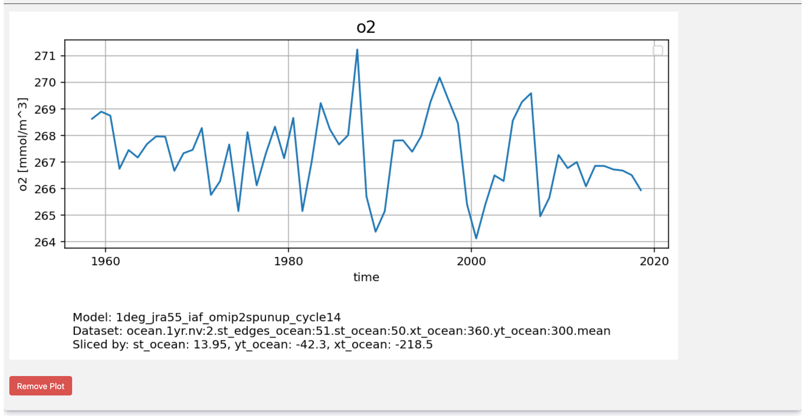{ width="70%" }

### 5. Comparing user and reference models
The **Overlay user and reference models** section compares your run with reference models, either as overlaid line plots or side-by-side heatmaps. It can also plot the difference between the user and reference datasets, to highlight where they differ.

- Select the user dataset to compare in **Select user dataset**, set the years to load, and click <span style="color:royalblue">**Load dataset**</span>. If you already loaded a dataset in [section 3](#3-loading-and-plotting-user-data), it is selected and loaded here automatically.

- Choose the variable to compare from the **Variable selection** dropdown.

- Select a reference model from the dropdown and click <span style="color:royalblue">**Add reference model**</span>. If the reference model has a dataset matching your user dataset, it loads automatically; if not, the model is skipped. Repeat this to add as many reference models as you like, or click <span style="color:darkred">**Clear loaded data**</span> to remove them all and start again. Then select a plot type (Line or Heatmap) and click <span style="color:green">**Select variable and plot type**</span>.

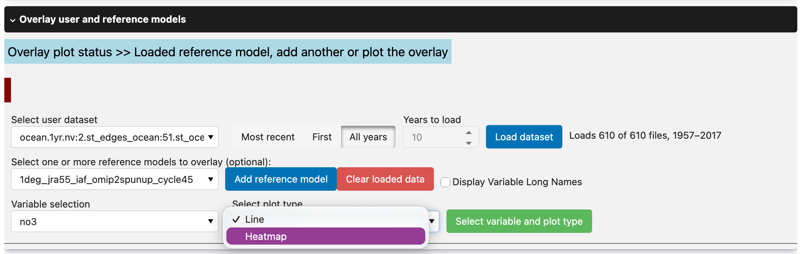{ width="70%" }

- Select the axes and choose an analysis type from the dropdown:

- **None (plot all loaded data)**: plots the datasets overlaid (or side by side for heatmaps).
- **Plot Difference (Ref. - User data)**: plots the difference between each reference dataset and the user dataset.
- **Plot All Data & Difference**: plots both the datasets and their differences.

Then click the <span style="color:green">**Select dimensions**</span> button.

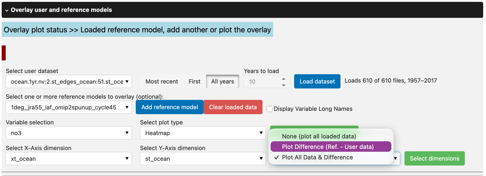{ width="70%" }

- If the variable needs slicing, sliders appear as in [section 3](#3-loading-and-plotting-user-data). For line plots, if the reference models cover a wider x-axis range than the user dataset (e.g. a longer time period), a **Choose how to constrain the x-axis bounds** dropdown also appears beside them:

- **Constrain to user dataset bounds**: zoom the x-axis to the range of the user dataset.
- **Constrain to min-max reference dataset bounds**: show the full range covered by all loaded datasets.

Choose your slices (and bounds, if asked) and click the <span style="color:green">**Plot data**</span> button to load the plots.

??? example "View comparison and difference heatmaps"
    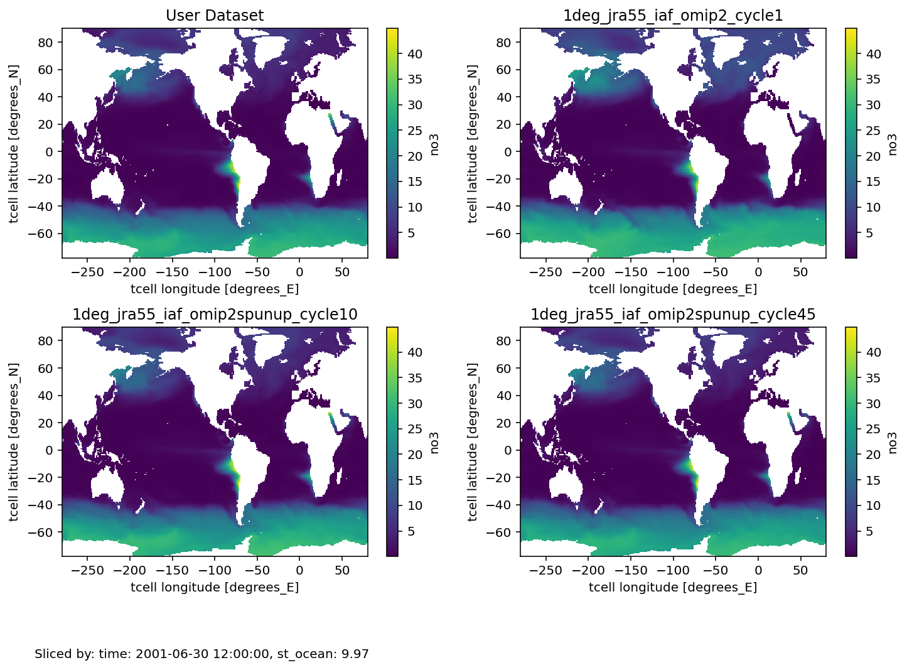{ width="70%" }

    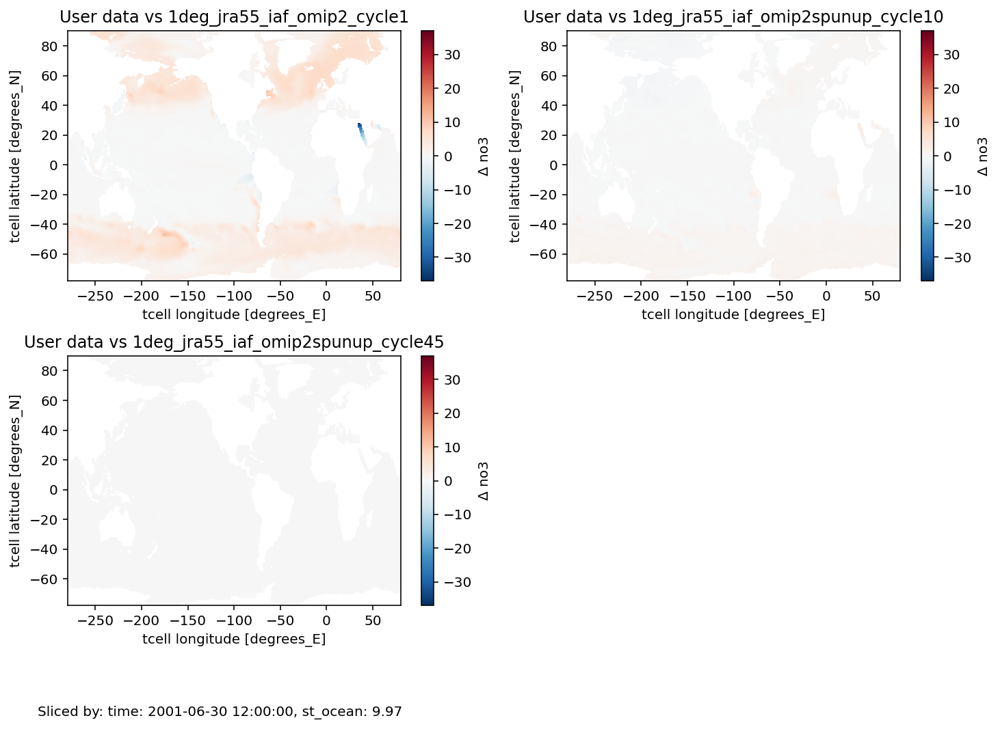{ width="70%" }

### 6. Running analysis recipes
The **Run analysis recipes** section runs predefined analyses ("recipes") on your user dataset, such as the Niño 3.4 sea surface temperature anomaly (`recipe_sst_anomaly_nino34`) or a regional mean on the MOM5 grid (`recipe_regional_mean_mom5`). See [Built-in analysis recipes](../built_in_recipes.md) for what each one does and the options it takes.

- Select the dataset in **Select dataset to analyse**, set the years to load, and click <span style="color:royalblue">**Load dataset**</span>. If you already loaded a user dataset in section 4.1 or 4.2, it is selected here automatically.

- Choose a recipe from **Select analysis recipe** and click <span style="color:green">**Select recipe**</span>. A description of the recipe appears, along with inputs for its options (e.g. the variable or region to use).

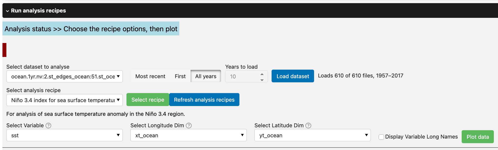{ width="70%" }

- Fill in the options and click <span style="color:green">**Plot data**</span>. As with the other sections, each plot has a <span style="color:darkred">**Remove the above plot**</span> button. To run the recipe again with different options, change them and click <span style="color:green">**Plot data**</span> again; the new plot appears above the older ones. If a recipe fails, the error is shown in the <span style="color:darkred">warning</span> box.

??? example "View analysis plot"
    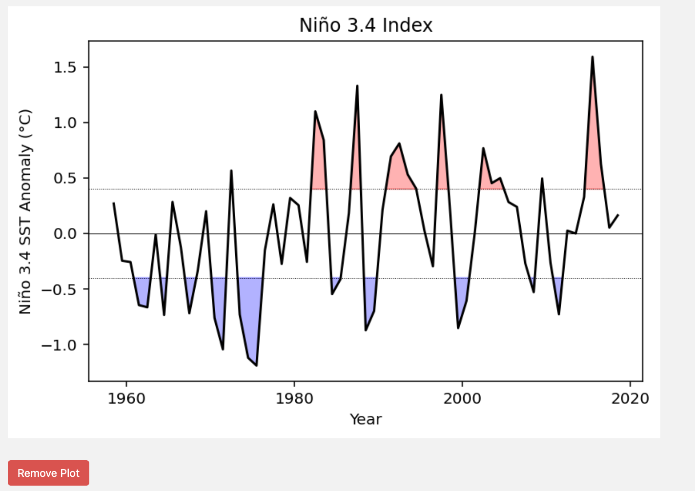{ width="70%" }

??? tip "Running a suite of analyses"
    Some recipes are **suites**: one click of <span style="color:green">**Plot data**</span> runs several analyses and adds one plot for each, in order. The status box then reads "Plots created". Each plot gets its own <span style="color:darkred">**Remove the above plot**</span> button, so you can remove the ones you don't need. Any recipe can be a suite, including your own (see [Running a suite of analyses](adding_custom_analyses.md#running-a-suite-of-analyses)).

If none of the predefined analyses suit your purpose, you can [write your own recipes](adding_custom_analyses.md).

### 7. End live model session

When you have finished, expand the **Start a model diagnostics session** section and click the <span style="color:darkred">**End Session**</span> button, or run:

```python
session.end_session()
```

This closes the Dask client and removes the session's sections, freeing up compute resources on Gadi. To start another session, enter a new path and model type and click <span style="color:green">**Start Session**</span>.

---

[Next: Adding custom analyses :material-arrow-right:](adding_custom_analyses.md){ .md-button }
